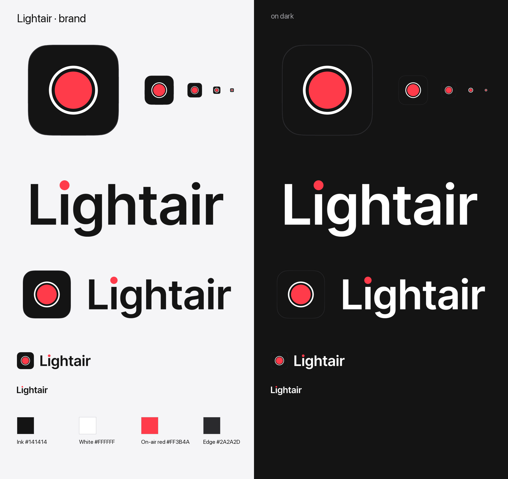

# Lightair Brand

The Lightair mark is the **on-air light**: a red dot in a white ring on an ink rounded square. The wordmark carries the same red dot over the first **i**. Flat, two colours plus one accent, no effects.



## Files

| Asset | Files | Use |
|---|---|---|
| **App icon** | `final/icon/Lightair.icns`, `lightair-icon.svg`, PNGs 16–1024 | macOS app bundle, website, store listings |
| **Small icon** | `final/icon/lightair-icon-small.svg` | Sizes ≤ 32 px (thicker ring, wider gap). The `.icns` already uses it for 16 and 32 px |
| **Wordmark** | `final/wordmark/lightair-wordmark-{ink,white}.svg` + PNGs (120/240/480 px tall) | Headers, docs, splash, social |
| **Lockup** | `final/lockup/lightair-lockup-{ink,white}.svg` + PNGs (120/240 px tall) | Website header, about window, slides |
| **Board** | `final/board.png` | Overview |

Use **ink** versions on light backgrounds and **white** versions on dark backgrounds. The red dot stays red in both.

## Colour

| Name | Hex | Role |
|---|---|---|
| Ink | `#141414` | Icon body, wordmark on light |
| White | `#FFFFFF` | Ring, wordmark on dark |
| On-air red | `#FF3B4A` | The dot, and nothing else in the logo |
| Edge | `#2A2A2D` | Hairline around the icon body so it stays visible on dark backgrounds |

These are the same values as the app's design system tokens (`bg.app`, `state.live`, `border.hairline`) in [06 · Design System](../docs/06-design-system.md). The interface follows the same rule as the logo: monochrome, with on-air red meaning "live" and nothing else.

## Construction

**Icon** (1024 × 1024 canvas, macOS grid):

| Element | Value |
|---|---|
| Body | 824 × 824 rounded square, centred; corner radius 185.4 with 60 % continuous-corner smoothing |
| Edge | 6 px inset hairline in Edge colour |
| Red dot | radius 20.5 % of body |
| Gap | 3.4 % of body |
| Ring | 3.0 % of body, white |
| Small variant | dot 19 %, gap 6 %, ring 7.5 %, no hairline |

**Wordmark:** "Lightair" set in **Inter SemiBold (600)**, tracking −0.02 em, Inter's own kerning. The tittle of the first **i** is replaced by an On-air red circle 1.18 × the tittle's size, raised so the gap to the stem stays the same. Outlines are converted to paths, so no font is needed to use the SVGs.

**Lockup:** icon height = 1.6 × cap height, centred on the cap height; gap between icon and wordmark = 0.38 × icon height.

## Usage

- **Clear space:** keep at least the height of the wordmark's red dot × 2 empty around the wordmark and lockup; around the icon, at least 10 % of its width.
- **Minimum size:** wordmark 64 px wide on screen (16 mm in print); lockup 96 px wide; icon 16 px (use the small variant at ≤ 32 px).
- **Don't:** recolour the dot, add gradients, glows or shadows, outline the wordmark, stretch or rotate it, set "Lightair" in another typeface next to the logo, or put the ink wordmark on dark backgrounds.

## Rebuilding

Everything in `final/` is generated from code:

```bash
python3 branding/source/build.py
```

The script draws the icon geometry, lays out the wordmark from Inter's outlines and kerning (`source/fonts/Inter-Variable.ttf`, instanced to SemiBold), writes the SVGs and PNGs, and builds `Lightair.icns` with `iconutil`. Change a value in `build.py` (for example the ring thickness or the dot scale) and re-run.

## Notes

- **Inter** is licensed under the SIL Open Font License 1.1. Add Inter's `OFL.txt` to `source/fonts/` before this folder is published or redistributed.
- **macOS 26+ icons:** the `.icns` works everywhere. For the full layered "glass" treatment that newer macOS versions apply to app icons, the same shapes (body, ring, dot) can be brought into Apple's Icon Composer as three layers.
- Earlier explorations are in `archive/` (round 1: glossy AI concepts; round 2: flat concepts, where this direction was chosen).
